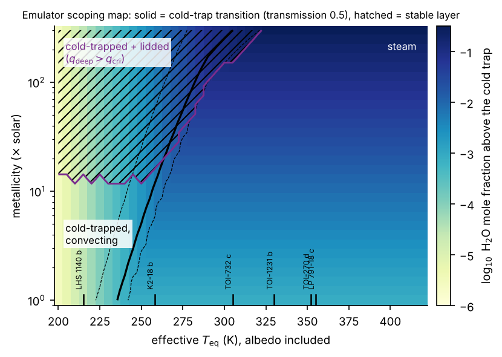

# meromixis

**Cold traps and chemoclines in temperate sub-Neptune atmospheres**

A meromictic lake is one that never turns over. A light upper layer rests on a dense,
solute-rich deep layer, and the thin chemocline between them passes almost nothing in
either direction. The thesis of this project is that a water-rich hydrogen atmosphere
can arrange itself the same way beneath its cloud deck, for the simple reason that in
H₂ the humid gas is the heavy gas. The implications of that inversion for the water and
ammonia seen in transmission are developed here with the Generic Planetary Climate
Model (PCM) and a one-dimensional emulator built around the same column physics.

## The physical problem

On Earth water vapor is a dilute condensible lighter than the air that carries it, so
moist air is buoyant and condensation only ever helps convection along. In a
hydrogen-helium envelope the situation is reversed. A water molecule weighs about 7.8
times the mean molecular weight of the background gas, so where the vapor mixing ratio
falls with height the mean molecular weight falls with it, and that compositional
gradient opposes the thermal one. Guillot (1995) first pointed out that this can shut
off moist convection in the giant planets. Leconte et al. (2017) turned the idea into a
threshold: convection is inhibited wherever the vapor mass fraction exceeds

    q_cri = 1 / (ϖ · d ln p_sat / d ln T),      ϖ = (M_v − μ_d) / M_v,

which at temperatures near 300 K is a few percent. Above that value no amount of
thermal buoyancy can lift a saturated parcel against its own weight, and the column
must carry its heat flux by radiation instead. The result is a stable layer sitting on
the cloud base, with a much steeper temperature gradient than the moist adiabat it
replaces. Leconte et al. (2024) confirmed with convection-resolving simulations that
the layer survives turbulent mixing and can remain stable while largely sub-saturated,
since the vapor gradient stabilizes whether or not the medium is saturated. Habib &
Pierrehumbert (2025) reached the same conclusion with a different model and found that
neither latent heat nor turbulent mixing carries much through the layer once it forms.
Innes & Pierrehumbert (2022) laid out the dry large-scale dynamics of the same class of
planet, which serves here as the benchmark for the dry control runs.

What has not been done is to put this layer into a global model that also resolves the
cold trap above it, and to ask what the combination does to observables. Two questions
follow from one water profile, and both are read off the same grid of runs.

| | Question | What decides it |
|---|---|---|
| **I. The cold-trap transition** | At what forcing does water get past the cold trap, how sharp is the switch, and does three-dimensional circulation move it? | The transition temperature T★(Z) and its width, in 3-D against 1-D, with limb-resolved water |
| **II. The ammonia barrier** | Is the stable layer tight enough to starve the upper atmosphere of NH₃, so that a deep envelope mimics the spectrum of a shallow surface? | The layer's resolved-flow diffusivity against the critical value K_crit(Z), with CO as the discriminator |

Result I lives on the boundary of the cold-trapped regime. Result II lives inside the
part of that regime where the deep vapor exceeds q_cri. CO is the discriminator because
a hot interior enhances it and nothing above the layer destroys it, so a lid that hides
NH₃ should leave CO in plain view.



*Regime map from the one-dimensional double-grey emulator. It was made to place GCM
runs, and it should be read as a design aid rather than a result.*

## What the emulator says

The approach follows the usual order: a scaling argument and a cheap column model set
expectations, and the GCM then confirms or corrects them. The emulator numbers below
come from an ensemble of about 9 000 column solves on a K2-18 b-like planet, with the
four grey radiative parameters that `rcm1d` has not yet pinned sampled as nuisance
parameters. The thermodynamics (composition, saturation, q_cri) is deliberately held
fixed, because that is the part of the answer that does not depend on the radiation
scheme.

* **The cold trap opens over a narrow interval of forcing.** T★ rises from 250 K at
  3× solar to 292 ± 10 K at 100× and 311 ± 15 K at 300× (1σ from the grey parameters).
  The transition is about 20 K wide at low metallicity and 27 K wide at 100× solar.
  The uncertainty in the transition's location is therefore as large as the
  transition itself, and the GCM forcing nodes cannot be placed until the grey scheme
  is calibrated against `rcm1d`. The thermal opacity κ_th dominates that uncertainty
  at every metallicity.
* **The stable layer has a sharp metallicity threshold.** Measured just below each
  draw's transition, the lid appears in none of the draws at Z ≤ 6× solar, in 36% at
  10×, in 93% at 15× and in all of them from 30× up. The 50% point sits near 11–12×.
* **The barrier works, but only inside a window of stellar UV.** The fraction of the
  ensemble in which the lid specifically hides NH₃ (hidden with inhibition, visible
  without it) is 66–82% over Z = 30–200 for a UV flux typical of an active M dwarf, at
  a photolysis efficiency η = 0.3. With too little UV, NH₃ survives whatever the lid
  does; with too much, it is destroyed whatever the lid does. A missing NH₃ feature
  identifies a lid only in between, so the host star's near-UV flux has to be measured
  before a non-detection can be interpreted. That is a population-level prediction
  that needs no GCM at all.
* **The thermal route is separate and weaker.** The hotter interior beneath a lid
  lowers NH₃ by a factor of about two at 100× solar and does essentially nothing below
  30×, so in the metallicity window where the transport barrier is most effective, the
  two mechanisms can be told apart.
* **CO behaves as hoped.** It is enhanced by the hotter interior (×1.6 at 50× solar,
  ×11 at 100×) and refills the upper atmosphere on 10²–10⁵ yr for layer diffusivities
  between 1 and 10⁻³ m² s⁻¹.

## What the first PCM runs say

Five runs have been carried out on Fir, a Digital Research Alliance of Canada (DRAC)
cluster, with Generic PCM trunk r4609, all in the
model's double-grey mode for the reason given below. Gate G1 is a pair of `rcm1d`
columns at T_eq = 265 K and 100× solar, with inhibition on and off, run for 19 200 days.
Gates G2 and G3 are 64 × 48 × 40 global runs of the same planet, dry and moist, the
moist one again with inhibition on and off, run for 50 days.

* In the G1 column the stable layer appears where the emulator puts it, from the
  bottom of the model at 69 bar up to about 1 bar, with q_deep/q_cri = 3.6. The
  inhibited column is 8 K warmer at the bottom. That difference is inherited from the
  initial state, however: the model holds it but does not create it, and whether a
  longer integration would build it up from an identical start has not been tested.
* In G3 the moist lid occupies the whole planet, from 69 bar up to 7–10 bar depending
  on whether the moist or Ledoux test bounds it. Switching inhibition off changes the
  temperature by less than 2.5 K anywhere but the bottom level. The circulation is a
  superrotating equatorial jet of about 70 m s⁻¹ near 8 mbar.
* The resolved-flow diffusivity through the layer is about 10⁻⁵ m² s⁻¹, well below
  K_crit. That number is not yet quotable. Fifty days is about 1.5 rotation periods,
  and the runs are far from spun up.

## Limitations

The caveats are gathered here, because several of them bound what either result can
claim.

1. **The dynamical core cannot feel the composition gradient.** The variable-composition
   thermodynamics option `thermo_binary_ideal` is accepted by the namelist parser but not
   implemented, and any run that sets it aborts; this holds in 1-D and 3-D alike. The
   lon-lat core therefore integrates a gas of uniform mean molecular weight, and the
   μ-gradient enters only through `virtual_theta_correction` and
   `moist_convection_inhibition` in the physics. Resolved overturning is computed
   without the buoyancy suppression the layer should provide, so the resolved K_zz is
   biased high. **Result II is consequently one-sided**: K_resolved < K_crit is a robust
   finding, but K_resolved > K_crit may be a property of the core rather than of the
   planet.
2. **The resolved K_zz is also a lower bound in another sense**, since it excludes
   sub-grid mixing by convective adjustment and turbulent diffusion. The two biases
   run in opposite directions and have not been separated.
3. **There is no correlated-k table for this problem.** The spectral runs need an
   H₂/He table with variable water out to x_H₂O ≈ 0.35. The public table from the Laboratoire de Météorologie Dynamique (LMD) stops at
   10⁻², which covers only Z ≲ 10× solar, below the lid threshold. Until one is
   generated (with Exo_k), every PCM run is double-grey.
4. **The emulator is double-grey and uncalibrated.** Clouds are radiatively inert, the
   gas is ideal to 1000 bar, and the UV flux and quench timescales in the kill test are
   estimates. The sharp-front NH₃ model reproduces the integrated photolysis loss to
   2–3% in the photon-limited regime, but its front *pressure* can be off by up to a
   factor of 70 and should not be quoted.
5. **The sweep design lags the gate-0 findings.** `experiments/steam_rising.yaml` still
   has its metallicity ribs at 3, 30 and 300× solar, all far from the lid threshold
   near 12×; a rib there is needed.

None of the emulator numbers above should be cited as a result. They exist to place
runs, to test the diagnostics, and to provide a one-dimensional baseline once the grey
scheme has been calibrated against `rcm1d` (`meromixis.column.calibrate_grey`).

## Status

| Component | State |
|---|---|
| Thermodynamics, cold-trap and stable-layer diagnostics, 1-D emulator | implemented and tested |
| Barrier kill test (supply against photolysis; thermal against transport) | implemented and tested; a self-shielded numerical solver checks the sharp-front model |
| 3-D diagnostics (limb-resolved cold trap; moist, Ledoux and union lid masks; flux-gradient K_zz) | implemented; the lid mask is bounded above by the water gradient |
| Generic PCM run generator and Fir job chain | keys audited against trunk r4609; start files built with `newstart` from an archived seed |
| Gate G0 (variable-composition thermodynamics) | closed, negatively |
| Gates G1, G2, G3 (double-grey) | run; G1 to 19 200 days, G2 and G3 to 50 days, not yet spun up |
| Spectral (correlated-k) sweep | blocked on the opacity table |

## Quick start

```bash
git clone https://github.com/wasnaqvi/meromixis.git && cd meromixis
pip install -e ".[dev]"
pytest

meromixis column --teq 255 --metallicity 100       # one emulator column
meromixis transition --metallicity 3 30 100        # where the cold trap opens
meromixis killtest --metallicity 30 --eta 1        # the ammonia-barrier kill test
python scripts/make_scoping_figures.py             # regenerate docs/figures/

meromixis pcm-init experiments/gate_grey.yaml runs/        # the double-grey gate runs
meromixis synth --teq 270 --out diagfi_synthetic.nc        # synthetic PCM output ...
meromixis diag diagfi_synthetic.nc --gravity 12.43 --metallicity 100   # ... through the real pipeline
```

On real output, `meromixis diag segments/diagfi*.nc --gravity ... --metallicity ... --last-n 40`
prints the region-by-region cold-trap table (Result I) and the lid's area fraction and
resolved-flow K_zz (Result II). `scripts/pcm/checks/gate_g1.py` and `gate_g3.py` run the
gate comparisons; set `MEROMIXIS_RUNS` to point them at a local copy of the run
directories.

## Layout

```
src/meromixis/
  composition.py   metallicity -> mole and mass fractions, dry-gas mu and cp
  thermo.py        water saturation (Murphy-Koop + Wagner-Pruss, or the PCM's constant-L form), adiabats
  inhibition.py    q_cri, Ledoux N^2, stable-layer finder
  coldtrap.py      rain-out profile, cold-trap level and transmission (1-D and n-D)
  column.py        1-D grey radiative-convective emulator with inhibited layers; calibrate_grey()
  regimes.py       steam / cold-trapped / lidded classification, transition finder
  chemistry.py     NH3 and CO equilibrium and quenching
  barrier.py       K(p), series resistance, K_crit, sharp-front and self-shielded NH3 profiles
  diagnostics3d.py the same diagnostics on (time, lev, lat, lon) output; flux-gradient K_zz
  synthetic.py     PCM-format synthetic output for testing the pipeline
  pcm/             .def and start-profile renderers, sweep expansion, Slurm chain, output I/O
experiments/       steam_rising.yaml (spectral sweep), gate_grey.yaml (runnable gates), targets.yaml
scripts/
  campaign/        the gate-0 emulator ensemble (transition, kill test, checks)
  pcm/             Fir build helpers, datagcm assembly, job scripts, gate analysis in checks/
  dev/             regenerates the thermochemical tables
docs/              science case, experiment design, Fir runbook, verification checklist
tests/             unit and end-to-end tests
```

## Documents

* [`docs/science_case.md`](docs/science_case.md): literature map, the two gaps, hypotheses, outcome matrix
* [`docs/experiment_design.md`](docs/experiment_design.md): gates, tiers, convergence criteria, figure-to-function map
* [`docs/pcm_on_fir.md`](docs/pcm_on_fir.md): building and running on DRAC Fir
* [`docs/VERIFY.md`](docs/VERIFY.md): everything written from memory or not yet checked against a run

These predate the gate-0 campaign. Where they disagree with this README, in particular
on the DYNAMICO fallback and on the two-sided outcome matrix for Result II, this README
is the more recent account.

## Citing

See `CITATION.cff`. The Generic PCM is developed at LMD and collaborators and is not
distributed here. The physics this project leans on is that of Guillot (1995), Leconte
et al. (2017, 2024), Charnay et al. (2021), Innes & Pierrehumbert (2022) and Habib &
Pierrehumbert (2025); please cite those papers alongside any use of this code.

## License

MIT. See `LICENSE`.
